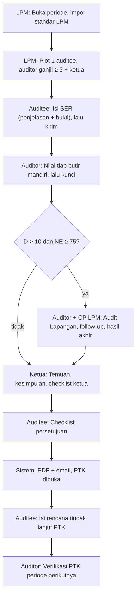
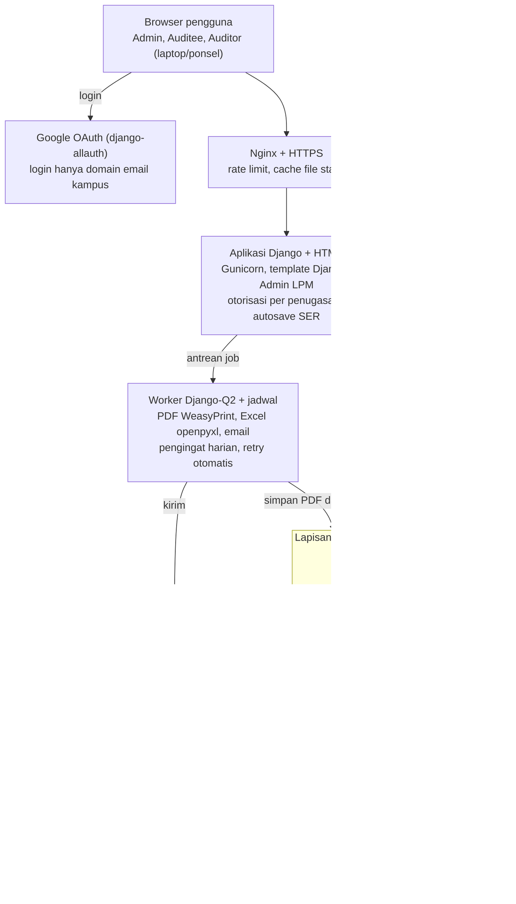

# BRD — SI-AMI v2 (Sistem Informasi Audit Mutu Internal SCU)

31 Oktober 2026 · Johanes Arya Pramesta Nugraha

## 1. Ringkasan Eksekutif & Latar Belakang

SI-AMI v2 menggantikan v1 (amitra.cloud) dengan aturan penilaian yang mengikuti Daftar Tilik LPM SCU: 1 auditee dinilai minimal 3 auditor (jumlah ganjil), nilai efektif dibandingkan KKM 75, dan deviasi antar-auditor di atas 10 poin dengan nilai efektif minimal 75 memicu tindak lanjut. Masalah v1 bukan terutama soal bahasa pemrograman, melainkan logika bisnis yang tidak sama dengan proses klien, alur UI yang membingungkan, dan infrastruktur shared hosting yang tidak siap untuk akses serentak menjelang deadline.

**Kondisi saat ini (as-is).** Sebelum v1, AMI dikelola manual dengan spreadsheet Daftar Tilik per unit (sheet Identitas AMI, Daftar Tilik, Temuan Kelebihan, Temuan KTS/OB, Peluang Peningkatan, PTK). Rekap lintas unit, notifikasi deadline, dan arsip lintas periode dikerjakan tangan oleh LPM.

**Masalah utama v1** (dari catatan superadmin, catatan revisi klien, dan user guide v1):

- Skala skor tidak sesuai: v1 memakai KTS/OB/PP/PB (0–3), sedangkan klien memakai skala 1–4 (KTS, OB, Sesuai, Pelampauan), dan auditee tidak lagi memberi skor angka.
- Perhitungan nilai efektif, KKM 75, rata-rata seluruh auditor, deviasi 10 poin, follow-up, dan hasil akhir setelah follow-up belum ada.
- Plot User gagal dengan pesan "koneksi server gagal"; tim auditor tidak bisa diisi.
- Nomor surat diisi satu set per audit, padahal PTK berjumlah lebih dari satu dan per auditee.
- Tab Setting tidak berfungsi; halaman Formula Skor dan Formula Deviasi tampak identik.
- PDF dibuat sinkron di request pertama ("PDF sedang dibuat", harus klik ulang); perbaikan error bergantung pada `php artisan` di terminal cPanel.
- Belum ada riwayat periode lalu, tren, rapor Excel per fakultas/prodi, email PDF, dan notifikasi H-3.

**Tujuan v2.**

1. Proses AMI satu siklus penuh (perencanaan → SER → review auditor → finalisasi → PTK → tindak lanjut) berjalan di sistem tanpa spreadsheet paralel.
2. Hasil perhitungan sistem sama persis dengan Daftar Tilik Excel LPM untuk data yang sama.
3. Sistem tetap responsif saat seluruh auditee dan auditor mengakses serentak di hari deadline.
4. Setiap peran menyelesaikan tugasnya tanpa pelatihan panjang: satu halaman tugas, satu tombol aksi utama per langkah.

## 2. Ruang Lingkup & Stakeholder

Rilis pertama mencakup satu siklus AMI penuh untuk semua jenis unit, termasuk PTK dan verifikasi tindak lanjut periode lalu; integrasi dengan sistem kampus lain di luar Google Login ditunda.

**Dalam lingkup (in-scope)**

- Master data: periode/jadwal, unit (fakultas, prodi S1/S2/S3/Profesi, lembaga, biro, UPT), pengguna, standar & pernyataan standar, template dokumen.
- Standar LPM (input/impor massal oleh LPM) dan standar turunan opsional per fakultas/prodi.
- Penugasan: 1 auditee, auditor berjumlah ganjil minimal 3 (3, 5, 7, …), 1 ketua auditor per audit.
- Pengisian SER oleh auditee (penjelasan + tautan/unggah bukti, tanpa skor angka).
- Penilaian independen oleh semua auditor, perhitungan nilai efektif, deviasi, follow-up, hasil akhir.
- Temuan (Kelebihan, KTS/OB, Peluang Peningkatan), PTK per temuan dengan nomor surat sendiri.
- Finalisasi berbasis checklist (ketua auditor dan auditee), dokumen resmi PDF, email otomatis.
- Notifikasi deadline H-3 sampai H, dashboard monitoring, rapor Excel, grafik per butir, tren, riwayat.

**Di luar lingkup rilis pertama**

- Tanda tangan elektronik tersertifikasi (TTE BSrE/PSrE); v2 memakai unggah scan dokumen bertanda tangan.
- Integrasi otomatis ke SIAKAD/intranet, PDDikti, atau sistem akreditasi LAM/BAN-PT.
- Aplikasi mobile native (web harus responsif di ponsel).

| Stakeholder | Peran di sistem | Kepentingan utama |
| --- | --- | --- |
| LPM SCU (Kepala & staf) | Master Admin | Siklus tepat waktu, rekap seluruh unit, dokumen resmi seragam |
| Staf operasional LPM / CP LPM | Admin | Monitoring progres, membantu unit, menjadwalkan Audit Lapangan |
| Pimpinan unit (Dekan, Kaprodi, Kepala lembaga/biro/UPT) | Auditee | Mengisi SER mudah, melihat temuan dan riwayat unitnya |
| Dosen/tenaga kependidikan bersertifikat auditor | Auditor | Menilai cepat dengan bukti di satu layar |
| Ketua auditor | Auditor (Ketua) | Merumuskan temuan, kesimpulan, dan menyetujui laporan final |
| Pimpinan universitas (Rektorat) | Viewer laporan | Rapor dan tren mutu lintas fakultas/prodi |
| Tim pengembang | — | Spesifikasi yang tidak berubah-ubah, kriteria terima yang jelas |

## 3. Proses Bisnis AMI: As-Is vs To-Be

Proses to-be mempertahankan urutan resmi LPM, tetapi memindahkan perhitungan, rekap, dan pengiriman dokumen dari spreadsheet ke sistem.

**As-is (periode 2024/2025, Teknik Elektro).** Rapat pembukaan 24 Januari 2025 → auditee mengisi Dokumen Evaluasi Diri 24 Januari–8 Februari → auditor mengkaji 10–13 Februari → Audit Lapangan 20 Februari → penyusunan Laporan AMI 28 Februari. Tiga auditor mengisi kolom masing-masing di satu file Excel, nilai dihitung dengan rumus sel, lalu Temuan dan PTK disalin manual ke sheet lain dan ditandatangani fisik.

**Titik lemah as-is:** rumus bisa terhapus, tiga auditor bisa saling melihat skor sebelum selesai, tidak ada pengingat deadline, rekap lintas unit dikerjakan manual, dan temuan periode lalu harus dicari di file lama.

**Alur to-be** — deviasi > 10 dengan nilai efektif ≥ 75 memicu Audit Lapangan:



Sistem menghitung nilai per auditor, deviasi, dan nilai efektif begitu semua auditor mengunci; hanya audit dengan deviasi di atas 10 dan nilai efektif minimal 75 yang melewati Audit Lapangan sebelum ketua merumuskan temuan.

## 4. Peran & Hak Akses (RBAC)

Peran melekat pada penugasan per periode, bukan pada akun: satu dosen bisa menjadi auditee di unitnya dan auditor di unit lain pada periode yang sama, tetapi tidak boleh mengaudit unitnya sendiri.

| Kemampuan | Master Admin | Admin | Auditee | Auditor | Ketua Auditor | Viewer (Rektorat) |
| --- | --- | --- | --- | --- | --- | --- |
| Kelola periode, unit, pengguna, peran | Ya | Lihat | — | — | — | — |
| Kelola standar LPM & impor Excel | Ya | Ya | — | — | — | — |
| Tambah standar turunan unit | Setujui | Setujui | Ya (unitnya) | — | — | — |
| Plot penugasan (1 auditee, auditor ganjil ≥ 3, ketua) | Ya | Ya | — | — | — | — |
| Isi SER + bukti | — | — | Ya, sampai deadline auditee | — | — | — |
| Lihat SER auditee | Ya | Ya | Miliknya | Unit yang ditugaskan | Unit yang ditugaskan | — |
| Beri skor & catatan | — | — | — | Miliknya sendiri | Miliknya sendiri | — |
| Lihat skor auditor lain | Ya | Ya | Setelah final | Setelah ia mengunci penilaiannya | Ya | — |
| Rumuskan temuan, kesimpulan A/B/C, follow-up | — | — | — | Usul | Ya | — |
| Checklist persetujuan final | — | — | Ya | — | Ya | — |
| Buka kunci / reset status (dengan alasan tercatat) | Ya | — | — | — | — | — |
| Isi rencana & bukti tindakan koreksi PTK | — | — | Ya | — | — | — |
| Verifikasi tindak lanjut PTK | — | — | — | Ya | Ya | — |
| Unduh dokumen resmi unit | Semua | Semua | Unitnya | Unit yang ditugaskan | Unit yang ditugaskan | — |
| Rapor Excel, grafik, tren lintas unit | Ya | Ya | Unitnya | — | — | Ya (baca saja) |
| Audit log | Ya | Lihat | — | — | — | — |

Aturan tambahan: auditor tidak boleh ditugaskan ke unit tempat ia menjabat atau menjadi homebase; setiap buka-kunci, reset, dan perubahan skor setelah final wajib tercatat di audit log beserta alasan.

## 5. Kebutuhan Fungsional

Ada 52 kebutuhan; 42 berprioritas Must dan menjadi syarat rilis. Kolom Sumber merujuk ke catatan klien ("Revisi #n" = file *1 auditee ada 3 auditor*, "Superadmin" = *Catatan amitra – superadmin*, "4 poin" dan "AMI" = dua catatan rapat lainnya).

### 5.1 Akses & Akun

| ID | Kebutuhan | Prioritas | Sumber |
| --- | --- | --- | --- |
| FR-01 | Login Google SSO dibatasi domain email kampus; akun di luar domain ditolak | Must | Revisi #21 |
| FR-02 | Login email + password sebagai cadangan untuk akun tamu, dengan reset password via email | Should | User guide v1 |
| FR-03 | Pengguna baru otomatis berstatus "menunggu peran" sampai Admin menetapkan peran | Must | User guide v1 |
| FR-04 | Satu akun dapat memegang peran berbeda di audit berbeda; menu menyesuaikan peran aktif | Must | AMI |

### 5.2 Master Data

| ID | Kebutuhan | Prioritas | Sumber |
| --- | --- | --- | --- |
| FR-05 | CRUD periode/jadwal dengan tahapan bertanggal yang diatur saat membuat jadwal (tidak tetap): pengisian SER (deadline auditee), review auditor (deadline auditor), audit lapangan, finalisasi, tindak lanjut PTK; hanya satu periode aktif | Must | 4 poin, Laporan AMI |
| FR-06 | CRUD unit dengan tipe: Fakultas, Prodi S1, S2, S3, Profesi, Lembaga, Biro, UPT; prodi terhubung ke fakultas induk; pimpinan dan NPP | Must | Revisi #5 |
| FR-07 | CRUD standar dan pernyataan standar (kode, pernyataan, pertanyaan panduan, bobot, urutan, lingkup bidang) | Must | Revisi #6 |
| FR-08 | Setiap pernyataan standar diberi penanda berlaku untuk satu atau beberapa tipe unit | Must | Revisi #5 |
| FR-09 | Impor massal standar dari Excel dengan template, pratinjau, validasi baris error sebelum simpan | Must | Superadmin |
| FR-10 | Standar turunan (opsional) diajukan fakultas/prodi dan disetujui LPM sebelum dipakai | Should | AMI, Superadmin |
| FR-11 | Salin set standar dari periode lalu ke periode baru | Should | — |
| FR-12 | Halaman Pengaturan berfungsi: nama institusi, logo, kop, pola nomor surat per jenis dokumen dan kategori unit, KKM, ambang deviasi, penyesuaian temuan, bobot Kesimpulan A/B/C (default 60/30/10) | Must | Superadmin |

### 5.3 Penugasan (Plot User)

| ID | Kebutuhan | Prioritas | Sumber |
| --- | --- | --- | --- |
| FR-13 | Buat audit: pilih unit, lingkup bidang, 1 auditee, auditor berjumlah ganjil minimal 3 (3, 5, 7, …), 1 ketua dari antara mereka; jumlah genap ditolak | Must | Revisi #1 |
| FR-14 | Validasi konflik: auditor tidak mengaudit unitnya sendiri; tampilkan beban audit tiap auditor | Must | — |
| FR-15 | Plot massal via impor Excel (unit, auditee, daftar auditor, ketua) | Should | Superadmin |
| FR-16 | Auditor bisa melihat standar unit yang ditugaskan segera setelah diplot, sebelum SER dikirim | Must | AMI |
| FR-17 | Pesan error spesifik saat simpan gagal (bukan "koneksi server gagal") dan data form tidak hilang | Must | Superadmin |

### 5.4 SER Auditee

| ID | Kebutuhan | Prioritas | Sumber |
| --- | --- | --- | --- |
| FR-18 | Daftar pernyataan standar otomatis sesuai tipe unit dan lingkup audit | Must | Revisi #5 |
| FR-19 | Per butir: hasil/penjelasan, satu atau lebih bukti (tautan Google Drive atau unggah file), tanpa skor angka | Must | Revisi #3, 4 poin |
| FR-20 | Simpan otomatis tiap 30 detik dan saat pindah butir; indikator "tersimpan" | Must | FAQ v1 |
| FR-21 | Tampilkan temuan KTS/OB periode lalu beserta status PTK-nya di samping butir terkait | Must | Revisi #22 |
| FR-22 | Tombol Kirim SER dengan ringkasan butir kosong; aktif hanya jika semua butir wajib terisi | Must | Revisi #4 |
| FR-23 | Setelah kirim, SER terkunci; Admin bisa membuka kunci per audit dengan alasan | Must | FAQ v1 |
| FR-24 | Riwayat: auditee dapat membuka SER, nilai, temuan, dan dokumen periode yang sudah selesai | Must | Revisi #9 |

### 5.5 Penilaian Auditor

| ID | Kebutuhan | Prioritas | Sumber |
| --- | --- | --- | --- |
| FR-25 | Tampilan berdampingan: pernyataan, isian auditee, bukti, form penilaian | Must | 4 poin |
| FR-26 | Tiap auditor memberi skor 1–4 (KTS/OB/Sesuai/Pelampauan), dasar penilaian, dan kondisi faktual secara independen | Must | Daftar Tilik Elektro |
| FR-27 | Auditor mengunci penilaiannya; sistem menghitung nilai per auditor setelah semua auditor mengunci | Must | AMI |
| FR-28 | Sistem menghitung nilai efektif, deviasi, status KKM sesuai Bab 6 dan menampilkannya ke ketua dan Admin | Must | Revisi #14–15 |
| FR-29 | Jika deviasi melebihi ambang dan NE ≥ KKM: notifikasi ke ketua dan Admin, tampilkan CP LPM, buka tahap Audit Lapangan | Must | AMI |
| FR-30 | Field follow-up dan field hasil akhir setelah follow-up | Must | Revisi #18–19 |
| FR-31 | Tabel perbedaan penilaian per butir antar-auditor beserta catatan masing-masing auditor | Must | Revisi #8 |
| FR-32 | Kesepakatan kategori final per butir oleh ketua setelah diskusi tim | Must | Daftar Tilik |

### 5.6 Temuan, Kesimpulan & PTK

| ID | Kebutuhan | Prioritas | Sumber |
| --- | --- | --- | --- |
| FR-33 | Temuan otomatis dari kategori final: Kelebihan (Pelampauan), KTS/OB, dan Peluang Peningkatan (input ketua) | Must | Daftar Tilik |
| FR-34 | Ketua mengisi Kesimpulan A, B, C dengan opsi baku dan penjelasan, serta checklist Tujuan Audit a–f | Must | Laporan AMI |
| FR-35 | Satu PTK per temuan KTS/OB dengan kode PTK berurutan per audit dan nomor surat masing-masing | Must | Superadmin |
| FR-36 | Auditee mengisi akar masalah, rencana tindakan, target tanggal, PIC per PTK di sistem | Should | Form PTK |
| FR-37 | Auditor memverifikasi efektivitas tindak lanjut PTK periode lalu pada periode berikutnya | Should | Laporan AMI Lampiran D |

### 5.7 Finalisasi & Dokumen

| ID | Kebutuhan | Prioritas | Sumber |
| --- | --- | --- | --- |
| FR-38 | Checklist persetujuan final oleh ketua auditor, lalu checklist persetujuan oleh auditee | Must | Revisi #16–17 |
| FR-39 | Nomor surat otomatis dari pola per jenis dokumen dan per kategori unit (mis. Prodi A, Prodi B, Universitas), nomor urut terpisah per pola; bisa dikoreksi Admin sebelum final | Must | Superadmin |
| FR-40 | Dokumen PDF: Profil Auditee, Daftar Tilik lengkap (semua auditor + catatan), Temuan, PTK, Berita Acara, Laporan AMI | Must | Revisi #8, Laporan AMI |
| FR-41 | PDF dibuat di latar belakang; pengguna melihat status "diproses/siap" tanpa klik ulang | Must | FAQ v1 |
| FR-42 | Kirim PDF final ke email auditee dan semua auditor secara otomatis | Must | Revisi #20 |
| FR-43 | Unggah dan unduh scan dokumen bertanda tangan per jenis dokumen | Must | Superadmin |
| FR-44 | Laporan rekapitulasi seluruh auditee per periode dibuat otomatis | Should | Superadmin |

### 5.8 Monitoring, Notifikasi & Analitik

| ID | Kebutuhan | Prioritas | Sumber |
| --- | --- | --- | --- |
| FR-45 | Dashboard Admin: progres per audit (butir terisi, status tiap auditor), filter fakultas/tipe/status | Must | Revisi #7 |
| FR-46 | Banner + email pengingat H-3 sampai H tiap hari bagi auditee/auditor yang belum selesai | Must | Revisi #11 |
| FR-47 | Notifikasi in-app dan email untuk setiap perpindahan status | Must | — |
| FR-48 | Unduh rapor Excel per fakultas dan per prodi S1/S2/S3/Profesi berisi skor, status KKM, temuan | Must | Revisi #12–13 |
| FR-49 | Grafik per butir standar dalam satu periode (sumbu X butir, sumbu Y skor) | Should | Superadmin |
| FR-50 | Tren nilai efektif dan jumlah temuan per unit lintas periode | Should | Revisi #10 |
| FR-51 | Ekspor data mentah Excel per audit dan per periode | Should | User guide v1 |
| FR-52 | Mode simulasi/QA hanya tersedia di lingkungan staging, tidak di produksi | Must | User guide v1 §3.11 |

## 6. Aturan Bisnis

Semua angka di bab ini (skala 1–4, KKM 75, ambang deviasi 10, penyesuaian temuan, bobot Kesimpulan A/B/C) disimpan sebagai parameter di Pengaturan per periode, sehingga perubahan kebijakan LPM tidak memerlukan perubahan kode. Skala, batas nilai 100, penyesuaian temuan, dan bobot A/B/C dikonfirmasi klien pada 31 Oktober 2026; syarat follow-up, jumlah auditor ganjil, dan penggabungan A/B/C juga sudah dikonfirmasi; tinggal proporsi NE dan NK dalam hasil akhir yang masih terbuka (Bab 10.6).

### 6.1 Skala penilaian auditor

| Kategori | Nilai | Arti | Masuk ke |
| --- | --- | --- | --- |
| KTS (Ketidaksesuaian) | 1 | Dokumen tidak tersedia dan belum terimplementasi | Temuan KTS/OB → PTK |
| OB (Observasi) | 2 | Dokumen belum lengkap, tetapi sudah terimplementasi | Temuan KTS/OB → PTK |
| Sesuai | 3 | Dokumen lengkap dan terimplementasi dengan baik | — |
| Pelampauan | 4 | Dokumen dan implementasi melampaui standar | Temuan Kelebihan |

- BR-01: Auditee tidak memberi skor angka; auditee hanya mengisi hasil/penjelasan dan bukti (Revisi #3).
- BR-02: Setiap auditor wajib mengisi kategori dan "dasar penilaian" untuk setiap butir; kondisi faktual wajib untuk KTS dan OB.
- BR-03: Butir yang tidak berlaku bagi unit ditandai "Tidak berlaku" oleh ketua dan dikeluarkan dari pembagi.

### 6.2 Nilai per auditor (skala 100)

```latex
N_i = \frac{\sum_{b=1}^{n} s_{i,b}}{4n} \times 100
```

N_i = nilai auditor i; s = nilai 1–4 per butir; n = jumlah butir yang berlaku; 4 = nilai tertinggi (Pelampauan), sehingga N_i selalu di antara 25 dan 100. Unit yang semua butirnya "Sesuai" mendapat tepat 75, sama dengan KKM.

- BR-04: Nilai dihitung setelah semua auditor mengunci penilaian; sebelum itu auditor tidak melihat skor auditor lain.
- BR-05: Nilai per auditor maksimal 100; karena pembaginya nilai tertinggi (4), batas ini terpenuhi otomatis.

### 6.3 Deviasi antar-auditor

```latex
D = \max_{i=1..m} N_i - \min_{i=1..m} N_i \qquad m = 3, 5, 7, \dots
```

- BR-06: D dinyatakan dalam poin skala 100 (contoh: N = 80, 75, 68 → D = 12).
- BR-07: D ≤ 10, atau D > 10 tetapi NE < 75 → langsung ke perumusan temuan tanpa follow-up; deviasi tetap ditandai di dashboard Admin.
- BR-08: D > 10 dan NE ≥ 75 → status "Perlu Audit Lapangan": notifikasi ke ketua dan Admin, tampilkan nama dan kontak CP LPM, dan field follow-up terbuka.
- BR-09: Sistem menandai butir penyumbang deviasi, yaitu butir dengan nilai berbeda antar-auditor, beserta catatan tiap auditor.

### 6.4 Nilai efektif, KKM, dan hasil akhir

```latex
NE = \frac{1}{m}\sum_{i=1}^{m} N_i - 0{,}5\,K_{KTS} - 0{,}3\,K_{OB} + 0{,}25\,K_{Kel}
```

K = jumlah temuan final per jenis. Penyesuaian −0,5 per KTS, −0,3 per OB, dan +0,25 per Kelebihan dikonfirmasi klien dan dapat diubah di Pengaturan.

- BR-10: KKM = 75. NE ≥ 75 → "Memenuhi KKM"; NE < 75 → "Belum Memenuhi KKM".
- BR-11: Follow-up hanya dibuka bila D > 10 dan NE ≥ 75 (dikonfirmasi klien).
- BR-12: Hasil akhir = gabungan NE dan NK (BR-12b). Bila ada follow-up, ketua menetapkan NE setelah Audit Lapangan; NE awal tetap tersimpan untuk jejak audit.

**Bobot Kesimpulan A/B/C.** Ketua menilai Kesimpulan A (sistem dokumentasi), B (implementasi SPMI), dan C (tindak lanjut PTK periode lalu) dengan skala 1–4 (usulan), lalu dikonversi ke skala 100.

```latex
NK = 0{,}60\,A + 0{,}30\,B + 0{,}10\,C
```

- BR-12a: Bobot default 60/30/10 dapat diubah Master Admin di Pengaturan per periode; total bobot wajib 100%.
- BR-12b: NK digabung ke hasil akhir (dikonfirmasi klien). Proporsi NE dan NK dalam hasil akhir disimpan sebagai parameter; nilai default-nya menunggu keputusan LPM (Bab 10.6).

### 6.5 Temuan dan PTK

- BR-13: Kategori final per butir = kategori terbanyak (modus) di antara semua auditor; bila tidak ada satu kategori terbanyak, ketua menetapkan dan wajib menulis alasan.
- BR-14: Kategori final Pelampauan → Temuan Kelebihan; KTS/OB → Temuan Kekurangan + satu PTK; Peluang Peningkatan diisi manual oleh ketua.
- BR-15: Kode PTK berurutan per audit (PTK No. 001, 002, …); nomor surat PTK unik per PTK dan mengikuti pola per jenis dokumen dan kategori unit.
- BR-16: Jika tidak ada KTS/OB, dokumen PTK tidak dibuat dan laporan mencantumkan "Tidak ada temuan KTS/OB".
- BR-17: Temuan KTS/OB yang PTK-nya belum diverifikasi efektif muncul lagi di SER periode berikutnya pada butir yang sama.

### 6.6 Status audit

| Status | Masuk ketika | Siapa bertindak |
| --- | --- | --- |
| Belum Mulai | Audit diplot | Auditee |
| Pengisian SER | Auditee menyimpan butir pertama | Auditee |
| Penilaian Auditor | Auditee mengirim SER | Semua auditor (sub-status per auditor) |
| Rekonsiliasi | Semua auditor mengunci | Sistem menghitung D dan NE |
| Perlu Audit Lapangan | D > 10 dan NE ≥ 75 | Ketua, CP LPM |
| Perumusan Temuan | Syarat Audit Lapangan tidak terpenuhi, atau follow-up selesai | Ketua |
| Menunggu Persetujuan Auditee | Ketua mencentang checklist final | Auditee |
| Final | Auditee mencentang checklist | Sistem membuat PDF dan mengirim email |
| Tindak Lanjut PTK | Ada PTK terbuka | Auditee, lalu auditor memverifikasi |
| Ditutup | Semua PTK terverifikasi atau periode diarsipkan | — |

- BR-18: Auditee yang tidak menyetujui hasil dapat mengajukan keberatan tertulis sekali; ketua menanggapi sebelum status Final.

## 7. Kebutuhan Non-Fungsional

Target utama: 500 pengguna aktif serentak di hari deadline dengan waktu respons p95 di bawah 1,5 detik, tanpa data SER hilang. Angka 500 adalah asumsi kerja (unit × (1 auditee + minimal 3 auditor) + Admin) dan perlu diganti dengan jumlah unit SCU yang sebenarnya.

### 7.1 Performa & konkurensi

| ID | Kebutuhan | Target |
| --- | --- | --- |
| NFR-01 | Pengguna aktif serentak | 500 tanpa error, uji beban sampai 1.000 |
| NFR-02 | Waktu respons halaman/API | p95 < 1,5 detik; simpan butir SER < 500 ms |
| NFR-03 | Pembuatan PDF dan Excel | Asinkron di antrean; selesai < 60 detik per audit; tidak memblokir request lain |
| NFR-04 | Email dan notifikasi | Lewat antrean dengan retry otomatis 3 kali |
| NFR-05 | Konflik simpan bersamaan | Optimistic locking per butir; pengguna diberi tahu bila data berubah di tab lain |
| NFR-06 | Unggah bukti | Maks. 20 MB per file, langsung ke object storage, bukan lewat disk server web |

Akar masalah konkurensi v1 yang dijawab oleh NFR di atas: shared hosting cPanel membatasi jumlah proses PHP dan memori per akun; PDF dibuat di dalam request web sehingga satu unduhan menahan satu worker; tidak ada cache, antrean, atau indeks database yang dirancang untuk kueri dashboard.

### 7.2 Keamanan & privasi

| ID | Kebutuhan |
| --- | --- |
| NFR-07 | HTTPS wajib; sesi aman (HttpOnly, SameSite); timeout idle 60 menit |
| NFR-08 | Otorisasi diperiksa di server untuk setiap endpoint berdasarkan penugasan, bukan hanya menyembunyikan menu |
| NFR-09 | Perlindungan OWASP Top 10: CSRF, XSS, SQL injection, validasi tipe dan ukuran file, rate limit login |
| NFR-10 | Audit log tak terhapus untuk login, perubahan skor, buka kunci, reset, perubahan peran |
| NFR-11 | Data pribadi (NPP, email, telepon) hanya tampil ke peran yang berwenang, sesuai UU PDP |
| NFR-12 | Perintah simulasi/QA dan debug tidak aktif di produksi |

### 7.3 Ketersediaan & pemeliharaan

| ID | Kebutuhan |
| --- | --- |
| NFR-13 | Uptime 99,5% per bulan; 99,9% selama jendela pengisian SER dan review |
| NFR-14 | Backup database harian (retensi 30 hari) + backup sebelum setiap rilis; uji restore tiap semester |
| NFR-15 | Lingkungan terpisah: development, staging (dengan data dummy), production |
| NFR-16 | Deploy otomatis lewat CI/CD termasuk migrasi database; tidak ada perintah manual di server |
| NFR-17 | Monitoring error dan performa (mis. Sentry), alert ke pengembang |

### 7.4 Kegunaan (UX)

| ID | Kebutuhan |
| --- | --- |
| NFR-18 | Halaman "Tugas Saya" sebagai beranda setiap peran: daftar tugas, tenggat, satu tombol aksi utama |
| NFR-19 | Seluruh antarmuka berbahasa Indonesia dengan istilah LPM (SER, Pernyataan Standar, KTS, OB, Sesuai, Pelampauan, PTK) |
| NFR-20 | Stepper progres yang menunjukkan posisi audit dan langkah berikutnya |
| NFR-21 | Tidak ada aksi permanen tanpa ringkasan konfirmasi (kirim SER, kunci penilaian, persetujuan final) |
| NFR-22 | Responsif dari lebar 360 px; nyaman dipakai di laptop 13 inci untuk tampilan berdampingan auditor |
| NFR-23 | Aksesibilitas WCAG 2.1 AA: kontras, navigasi keyboard, label form |
| NFR-24 | Uji kegunaan dengan minimal 2 auditee dan 2 auditor sebelum rilis; tingkat penyelesaian tugas ≥ 90% tanpa bantuan |

## 8. Model Data Inti & Dokumen Keluaran

Model data dibangun di sekitar satu entitas Audit (unit × periode) dengan penilaian disimpan per auditor per butir, sehingga Daftar Tilik multi-auditor, deviasi, dan riwayat lintas periode bisa dihitung ulang kapan saja.

### 8.1 Entitas utama

| Entitas | Atribut kunci | Relasi |
| --- | --- | --- |
| Periode | nama, tahun akademik, tanggal tiap tahap, CP LPM, parameter skor (KKM, ambang deviasi, bobot) | punya banyak Audit |
| Unit | nama, tipe (Fakultas/Prodi S1/S2/S3/Profesi/Lembaga/Biro/UPT), pimpinan, NPP | Prodi → Fakultas induk |
| Pengguna | nama, email kampus, NPP, telepon, unit homebase | punya banyak Penugasan |
| Standar | kode, nama, bidang/lingkup, bobot, urutan, sumber (LPM/turunan) | punya banyak Pernyataan |
| Pernyataan Standar | kode (mis. 2.4\*), pernyataan, pertanyaan panduan, tipe unit yang berlaku, status aktif | milik Standar, versi per Periode |
| Audit | unit, periode, lingkup, status, tanggal audit lapangan, NE, D, hasil akhir | 1 auditee, minimal 3 auditor (ganjil) |
| Penugasan | audit, pengguna, peran (Auditee/Auditor/Ketua), status kunci | — |
| Jawaban SER | audit, pernyataan, hasil/penjelasan, waktu simpan, versi | punya banyak Bukti |
| Bukti | tautan atau file, nama, ukuran | milik Jawaban SER atau PTK |
| Penilaian | audit, pernyataan, auditor, nilai (1–4), dasar, kondisi faktual, versi | 1 per auditor per butir |
| Kategori Final | audit, pernyataan, kategori, cara penetapan (mayoritas/ketua), alasan | — |
| Temuan | audit, jenis (Kelebihan/KTS/OB/Peluang), pernyataan, uraian | KTS/OB → 1 PTK |
| PTK | kode PTK, nomor surat, akar masalah, rencana, target, PIC, status verifikasi, catatan verifikasi | dari Temuan; diverifikasi di periode berikutnya |
| Kesimpulan | audit, A/B/C (opsi + penjelasan), checklist tujuan a–f | — |
| Persetujuan | audit, pihak, waktu, catatan/keberatan | — |
| Dokumen | audit, jenis, nomor surat, file PDF, scan bertanda tangan, status pembuatan | — |
| Notifikasi, Audit Log | penerima/aktor, jenis, payload, waktu | — |

### 8.2 Dokumen keluaran

| Dokumen | Format | Isi | Dibuat saat |
| --- | --- | --- | --- |
| Profil Auditee (Identitas AMI) | PDF | Periode, hari/tanggal/jam AL, auditee, pimpinan, lingkup, ketua dan anggota auditor | Audit diplot |
| Daftar Tilik | PDF + Excel | Pernyataan, pertanyaan, isian auditee, bukti, skor dan catatan semua auditor, N per auditor | Final |
| Temuan AMI | PDF | A. Kelebihan, B. KTS/OB dengan kode PTK, C. Peluang Peningkatan | Final |
| PTK | PDF (1 per temuan) | Identitas, kategori, standar, uraian temuan, rencana tindakan, verifikasi | Final; diperbarui saat tindak lanjut |
| Berita Acara Audit Lapangan | PDF | Pelaksanaan AL, peserta, tanda tangan | Setelah AL / Final |
| Laporan AMI | PDF | Sampul, daftar isi, Pendahuluan, Tujuan (a–f), Lingkup, Jadwal, Temuan, Kesimpulan A/B/C, jumlah temuan, Lampiran A–D | Final |
| Rapor Fakultas/Prodi | Excel | Per unit: N per auditor, D, NE, status KKM, jumlah temuan, hasil akhir | Kapan saja oleh Admin |
| Rekap Periode | PDF + Excel | Semua auditee dalam satu periode, grafik per butir | Akhir periode |

Semua PDF memakai kop dan nomor formulir LPM (mis. 064-00/Unika/LPM/R-Q untuk Profil Auditee, 009-02 untuk Daftar Tilik) yang diatur di Pengaturan, bukan ditulis di kode.

## 9. Rekomendasi Arsitektur & Teknologi

Keputusan: SI-AMI v2 dibangun ulang dengan **Python + Django + HTMX**, PostgreSQL, Redis, dan worker antrean Django-Q2, di-deploy di VPS/cloud, bukan shared hosting cPanel. Bahasa pemrograman bukan penyebab v1 lambat saat diakses bersamaan. Penyebabnya adalah pekerjaan berat (PDF, email) yang dijalankan di dalam request web, ditambah hosting yang membatasi jumlah proses; kedua hal itu diselesaikan oleh arsitektur di bawah, apa pun bahasanya.

**Mengapa Django + HTMX.** Sebagian besar modul v1 memang harus dibangun ulang (Bab 10.1), jadi meninggalkan kode Laravel tidak banyak merugikan. Django sudah membawa login, hak akses, form, migrasi database, dan Django Admin untuk master data LPM, sehingga kode yang harus ditulis (dan diperiksa saat vibe coding) jauh lebih sedikit. Pengembang sudah terbiasa dengan Python, openpyxl, dan WeasyPrint, sehingga logika rumus Bab 6 bisa dibaca dan diverifikasi sendiri. HTMX membuat halaman interaktif tanpa memisahkan proyek frontend dan backend.

| Kebutuhan | Komponen di stack Django |
| --- | --- |
| Web dan halaman interaktif | Django (LTS), template Django, HTMX, Alpine.js untuk interaksi kecil, Tailwind CSS |
| Server aplikasi | Gunicorn di belakang Nginx (HTTPS, rate limit, file statis) |
| Database | PostgreSQL |
| Login Google domain kampus (FR-01) | django-allauth, dibatasi ke domain email kampus |
| Hak akses per penugasan | Permission Django + pemeriksaan penugasan di setiap view |
| Master data LPM (standar, unit, user, periode) | Django Admin yang dikustomisasi + impor Excel |
| PDF Laporan AMI, PTK, BA, Daftar Tilik (FR-40) | WeasyPrint: template HTML/CSS dengan kop dan logo SCU → PDF |
| Excel: impor standar dan rapor (FR-09, FR-48) | openpyxl |
| Email PDF final dan pengingat (FR-42, FR-46) | Backend email Django via SMTP Google Workspace |
| Antrean dan jadwal H-3 s.d. H (NFR-03, NFR-04) | Django-Q2 (worker + schedule) dengan Redis sebagai broker |
| Cache dan sesi | Redis |
| Unggah bukti dan arsip PDF | django-storages ke object storage S3-compatible |
| Audit log | django-auditlog atau model log buatan sendiri |
| Tes rumus Bab 6 | pytest + pytest-django |

Pembanding yang dipertimbangkan: Laravel + Inertia React (melanjutkan v1, tetapi tetap perlu bangun ulang sebagian besar modul) dan Go (paling ringan, tetapi tanpa panel admin bawaan dan kodenya lebih panjang).

**Arsitektur** — satu aplikasi web, pekerjaan berat dipindah ke antrean:



Pengguna hanya berinteraksi dengan aplikasi Django. Semua pekerjaan lambat (PDF, rapor Excel, email, pengingat H-3) dikerjakan worker Django-Q2 lewat antrean Redis, sehingga lonjakan unduhan di hari deadline tidak memperlambat pengisian SER.

**Spesifikasi awal server (disesuaikan setelah uji beban):** 1 VPS 4 vCPU / 8 GB RAM untuk Nginx, Gunicorn, worker Django-Q2, dan Redis; PostgreSQL terkelola atau di VPS kedua; object storage S3-compatible; domain dengan sertifikat TLS. Semua dijalankan dengan Docker Compose agar staging dan produksi identik.

**Praktik pengembangan wajib:** repositori Git milik kampus; CI/CD (tes otomatis + `migrate` saat deploy); tes pytest untuk seluruh rumus Bab 6 dengan contoh hitung yang disetujui LPM sebagai acuan, ditulis sebelum fitur lain; uji beban (mis. k6 atau Locust) sebelum setiap periode audit; `DEBUG=False` dan perintah simulasi QA hanya aktif di staging.

## 10. Gap Analysis, Risiko, KPI, Roadmap & Pertanyaan Terbuka

Dari 22 poin revisi klien, 9 ditandai "X" di catatan (diasumsikan sudah dikerjakan di v1) dan 13 belum; namun 3 poin bertanda X (#1, #3, #5) tetap perlu dibangun ulang dan 1 (#11) perlu diverifikasi karena logika v1 berbeda dari Daftar Tilik.

### 10.1 Gap v1 terhadap kebutuhan

| Area | Kondisi v1 | Kebutuhan v2 | Tindakan |
| --- | --- | --- | --- |
| Skala skor | KTS/OB/PP/PB, auditee ikut memberi skor | Skala 1–4, auditee tanpa skor | Bangun ulang |
| Tim auditor | Minimal 3, Plot User sering gagal | Ganjil minimal 3 + ketua, validasi konflik | Bangun ulang |
| Perhitungan | Formula bebas (ekspresi), skor dan deviasi tampak sama | Rumus tetap + parameter (Bab 6) | Bangun ulang |
| Deviasi & AL | Banner deviasi tinggi saja | Notifikasi, CP LPM, follow-up, hasil akhir | Baru |
| Temuan & PTK | PTK dari skor auditor tunggal, satu nomor surat | Kategori final, 1 PTK per temuan, nomor per PTK | Bangun ulang |
| Persetujuan | Sign-off tanpa checklist | Checklist ketua lalu auditee, keberatan | Perbaiki |
| Dokumen | PDF sinkron, butuh klik ulang | Antrean, status siap, email otomatis | Bangun ulang |
| Standar per tipe unit | Mode LPM/kustom sekali pilih | Penanda tipe unit + turunan disetujui LPM | Bangun ulang |
| Riwayat, tren, rapor | Tidak ada | Riwayat auditee, tren, rapor Excel | Baru |
| Notifikasi H-3 | Ditandai X | Banner + email harian H-3 s.d. H | Verifikasi |
| Pengaturan | Tab tidak berfungsi | Parameter periode, kop, nomor surat | Perbaiki |
| QA otomatis | Tersedia di produksi | Hanya staging | Pindahkan |

### 10.2 Risiko

| Risiko | Dampak | Mitigasi |
| --- | --- | --- |
| Rumus nilai efektif ditafsirkan berbeda oleh LPM | Hasil tidak diakui, rilis mundur | Konfirmasi tertulis + uji dengan contoh hitung yang disetujui LPM |
| Lonjakan akses di hari deadline | Sistem lambat, SER hilang | Uji beban 1.000 pengguna, autosave, antrean, server khusus |
| Kebutuhan bertambah di tengah pengembangan | Jadwal molor | Perubahan setelah BRD disetujui melalui change request dan masuk fase berikutnya |
| Adopsi rendah oleh auditor senior | Kembali ke spreadsheet | Uji kegunaan, panduan singkat per peran, sesi pelatihan 1 jam |
| Ketergantungan pada satu pengembang | Sistem tidak terpelihara | Kode di repositori kampus, dokumentasi deploy, framework populer |

### 10.3 Asumsi

- Seluruh pengguna memiliki akun Google domain kampus.
- LPM menyediakan server/VPS atau anggaran cloud, bukan shared hosting.
- Satu periode AMI per tahun akademik, dengan tanggal tiap tahap diatur LPM saat membuat jadwal audit.
- "X" pada catatan revisi berarti poin sudah dikerjakan di v1.

### 10.4 KPI keberhasilan

| KPI | Target |
| --- | --- |
| Audit periode berikutnya yang diselesaikan penuh di sistem | 100% unit |
| Selisih hasil sistem vs contoh hitung LPM pada data uji | 0 |
| Ketepatan waktu pengisian SER | ≥ 90% auditee sebelum deadline |
| Waktu LPM menyusun rekap periode | Turun dari hitungan hari menjadi < 1 jam |
| Tiket bantuan per pengguna selama periode | < 0,1 |
| Ketersediaan selama jendela audit | ≥ 99,9% |

### 10.5 Roadmap usulan

1. Fase 0 — Persetujuan BRD dan jawaban pertanyaan terbuka; gerbang: BRD ditandatangani LPM.
2. Fase 1 — Fondasi: auth Google, master data, impor standar, penugasan, infrastruktur dan CI/CD.
3. Fase 2 — Inti audit: SER, penilaian multi-auditor, perhitungan, deviasi, follow-up, temuan, persetujuan; gerbang: tes rumus Bab 6 dengan contoh hitung LPM lulus 100%.
4. Fase 3 — Dokumen dan notifikasi: PDF/Excel di antrean, email, pengingat H-3, dashboard.
5. Fase 4 — UAT dengan 2–3 unit pilot dan uji beban; gerbang: KPI kegunaan dan performa tercapai.
6. Fase 5 — Go-live periode berikutnya; lalu riwayat, tren, grafik per butir, tindak lanjut PTK, dan standar turunan.

### 10.6 Keputusan Klien & Pertanyaan Terbuka

| Topik | Keputusan klien (31 Okt 2026) |
| --- | --- |
| Skala penilaian | 1–4 sesuai catatan "4 poin": KTS 1, OB 2, Sesuai 3, Pelampauan 4 |
| Batas nilai per auditor | Maksimal 100 |
| Jumlah auditor | Minimal 3 per auditee, berlaku kelipatan ganjil (3, 5, 7, …) |
| Penyesuaian temuan | −0,5 per KTS, −0,3 per OB, +0,25 per Kelebihan terhadap nilai efektif; bisa diubah di Pengaturan |
| Syarat follow-up | D > 10 dan NE ≥ 75 |
| A 60, B 30, C 10 | Bobot Kesimpulan A/B/C; default 60/30/10, bisa diubah; NK digabung ke hasil akhir |
| Deadline auditee dan auditor | Tidak tetap; diatur saat membuat jadwal audit |
| Nomor surat | Per jenis dokumen dan per kategori unit (Prodi A, Prodi B, Universitas, dll.) |
| Tanda tangan | Untuk saat ini unggah scan dokumen bertanda tangan |

Masih terbuka:

- [ ] Proporsi NE dan NK dalam hasil akhir, dan apakah Kesimpulan A/B/C dinilai dengan skala 1–4.
- [ ] Jumlah unit yang diaudit per periode dan jumlah auditor aktif, untuk menentukan ukuran server (tidak menghambat pengembangan).
- [ ] Contoh pola nomor surat lengkap untuk setiap jenis dokumen.
